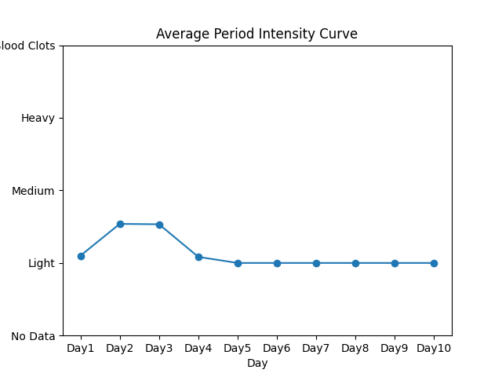

# Menstrual-Symptoms-Analysis-
I'm just trying to find whether the birth controls and menstrual hormones have been f**king me up and how have they been f-king me up

<u>Tools:</u> python, jupyter notebook, git, github 

<u>Libraries:</u> see requirements.txt

**Ongoing Analysis**:

This plot tells me stuffs like if I'm nausous and I will be angry as well, or if I'm angrying then I will be panicing as well(??) hmm.. the hormonal hell

The plot under compares my average period and cycle length with the regular period and cycle length according to [Mayo Clinic](https://www.mayoclinic.org/healthy-lifestyle/womens-health/in-depth/menstrual-cycle/art-20047186). Note that I was on Kyleena for this whole time, and I’ve noticed my menstrual cycle has been prolonged since starting Kyleena. 

Orange see-through area is the window for regular cycle length, my cycle length is the orange line with dots. So you see that my cycle length (orange stuffs in the plot) is off the f**king charts thanks to the stupid side effects of birth control. 

This one shows the period intensity for each day for all my periods. Distinct values in data are 1-4 where 1 represents light, 2 for medium, 3 for heavy and 4 for blood clots. My period intensity has been pretty light overall, and I've been lazy logging my period intensity for a good while. And also can I say this is the kind of overview I don't get from Fl* while I'm paying 169NOK for my yearly subscription. #whatamipayingfor

